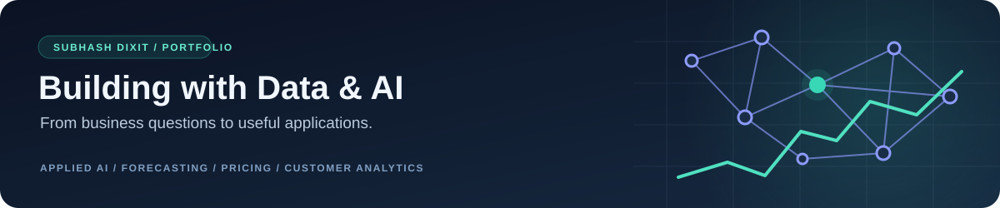

<h1 align="center">Subhash Dixit</h1>

<strong>Senior Data Scientist · Applied AI · Forecasting · Pricing · Customer Analytics</strong>

EPAM Systems &nbsp;•&nbsp; Kolkata, India &nbsp;•&nbsp; NIT Durgapur

  
  
  

<a href="PROJECTS.md"><strong>Explore 37 live applications</strong></a> &nbsp; | &nbsp; <a href="https://github.com/subhashdixit/learning-hub"><strong>Learning Hub</strong></a> &nbsp; | &nbsp; <a href="#professional-experience"><strong>Experience</strong></a>

---

I use predictive analytics and machine learning to turn business questions into data products: forecasting demand, understanding price and promotion effects, analysing customer behaviour, and building reliable applications. I have 5+ years of experience across consumer goods, gaming and analytics, with roles at EPAM Systems, WNS Analytics, Affine Analytics and TCS.

Alongside my data science work, I build **applied AI tools for document intelligence, research and knowledge discovery**. My portfolio includes local LLM inference, document retrieval, summarisation, OCR and editable AI-generated drafts, with attention to privacy, evaluation and usable interfaces.

## What I work on

- **Forecasting and planning:** demand forecasting, baseline sales, seasonality, promotional uplift and revenue planning.
- **Pricing and product analytics:** price elasticity, product mapping, SKU hierarchies and competitive intelligence.
- **Customer and text analytics:** segmentation, retention, sentiment analysis and evidence-based document tools.
- **Applied AI portfolio:** document question answering, source-grounded research, local LLMs, OCR and document summarisation.
- **Reliable delivery:** data validation, reusable Python packages, web interfaces, testing, CI/CD and deployment.

## Applied AI and document intelligence

I turn AI concepts into applications people can try. These are independent portfolio projects, alongside my forecasting, pricing and customer analytics experience.

| Application | AI work and practical use |
|---|---|
| [AI Research Workbench](https://github.com/subhashdixit/ai-research-workbench) | Collect attributed research-feed excerpts and turn supplied evidence into summaries and editable local-LLM briefings. |
| [Equity Research Assistant](https://github.com/subhashdixit/equity-research-assistant) | Retrieve relevant financial-document passages with BM25 and use that evidence for source-linked answer drafts. |
| [Document Summarizer](https://github.com/subhashdixit/document-summarizer) | Extract text from PDFs, create extractive summaries and generate editable summaries with a local language model. |
| [Invoice Extraction Studio](https://github.com/subhashdixit/invoice-extraction-studio) | Combine English/Hindi OCR, structured field extraction and arithmetic reconciliation with optional OCR-grounded LLM reading. |
| [Multimodal Assistant](https://github.com/subhashdixit/multimodal-assistant) | Explore OCR-first image workflows, text analysis and explicitly experimental small-model vision inference. |
| [Course Q&A Assistant](https://github.com/subhashdixit/course-qa-assistant) | Retrieve existing FAQ evidence and inspect original answers before generating an optional model draft. |
| [Cover Letter Studio](https://github.com/subhashdixit/cover-letter-studio) | Compare a supplied profile with job requirements and produce editable, exportable application drafts. |

**Implementation stack:** Hugging Face Transformers.js, ONNX Runtime Web, WebAssembly, Web Workers, PDF.js and Tesseract.js. The local-model options include Qwen2.5, SmolLM2 and experimental SmolVLM vision. Model revisions and library versions are pinned in the repositories.

**Engineering focus:** source attribution, bounded inputs, background inference, cancellation, local processing and human review. Small models can hallucinate; retrieved evidence and OCR transcripts remain visible so users can check the output.

**Continuing learning:** RAG architecture, embeddings and vector databases, LangChain, LangGraph, agent workflows, and spec-driven development with Claude. My Learning Hub records these topics as I build and refine the practical examples.

## Selected projects

These are public portfolio and learning applications. Their README files explain the data, methods, measured results, limitations and local setup.

| Project | What you can explore | Live app | Source |
|---|---|---|---|
| Hierarchical Text Classifier | Constrained multi-level text classification through a Flask UI and API | [Launch](https://hierarchical-text-classifier.onrender.com/) | [Repository](https://github.com/subhashdixit/hierarchical-text-classifier) |
| Credit Risk Classifier | Model-based risk scoring, validation and a documented prediction workflow | [Launch](https://credit-risk-classifier-r0ig.onrender.com/) | [Repository](https://github.com/subhashdixit/credit-risk-classifier) |
| Energy Forecast Explorer | Historical energy patterns and comparisons between forecasting approaches | [Launch](https://subhash-energy-forecast.streamlit.app/) | [Repository](https://github.com/subhashdixit/energy-demand-forecaster) |
| Invoice Extraction Studio | Local English/Hindi OCR, editable invoice fields and total reconciliation | [Launch](https://subhashdixit.github.io/invoice-extraction-studio/) | [Repository](https://github.com/subhashdixit/invoice-extraction-studio) |
| Equity Research Assistant | Financial-document search, evidence retrieval and optional local-model drafts | [Launch](https://subhashdixit.github.io/equity-research-assistant/) | [Repository](https://github.com/subhashdixit/equity-research-assistant) |
| Spendly | Expense tracking, category/date filters and portable browser-local backups | [Launch](https://subhashdixit.github.io/spendly/) | [Repository](https://github.com/subhashdixit/spendly) |

**[Browse all 37 application repositories and live links →](PROJECTS.md)**

Free hosting can take time to wake. Browser AI tools download their selected model on first use and need a compatible device. Browser-local apps keep their working data on your device; export backups where supported. Each project documents its own operating boundaries.

## Professional experience

| Organisation | Roles | Areas of work |
|---|---|---|
| **EPAM Systems** | Senior Data Scientist; previously Data Scientist 2 | Baseline forecasting, price elasticity, promotional response, product mapping, data quality and SKU hierarchies |
| **WNS Analytics** | Assistant Manager — Data Science | Sales forecasting, model optimisation and team coordination for demand planning |
| **Affine Analytics** | Senior Associate Data Scientist; previously Associate Data Scientist | Player segmentation, retention, revenue forecasting, sentiment analysis and competitive intelligence |
| **Tata Consultancy Services** | Assistant System Engineer | Process automation and release management |

My employment case studies and career documents are maintained separately from the public portfolio applications.

## Skills and tools

| Area | Technologies and methods |
|---|---|
| Programming and data | Python, SQL, PySpark, Excel |
| Machine learning and statistics | scikit-learn, XGBoost, regression, classification, clustering, A/B testing, SHAP |
| Forecasting and econometrics | ARIMA, SARIMA, Prophet, exponential smoothing, price elasticity and promotional modelling |
| NLP and text analytics | Sentiment analysis, VADER, n-grams, document extraction and BM25 retrieval |
| Applied AI and local inference | LLMs, Transformers.js, ONNX Runtime Web, WebAssembly, Qwen2.5 and SmolLM2 |
| Document and image AI | PDF.js, Tesseract.js, English/Hindi OCR, structured invoice extraction and experimental SmolVLM vision |
| AI engineering learning | RAG, embeddings, vector databases, LangChain, LangGraph, agents and spec-driven development |
| Platforms and delivery | Databricks, AWS, Flask, Streamlit, HTML/JavaScript, Docker, Git, GitHub Actions, Render and Cloudflare |

## Education and continued learning

- **B.Tech, Civil Engineering — National Institute of Technology, Durgapur** · 2017–2021 · CGPA **8.71/10**.
- **iNeuron Full Stack Data Science Bootcamp** · 2022–2023 — [coursework collection](https://github.com/subhashdixit/ineuron-bootcamp).
- **Advanced Regression Training — IIM Bangalore** · five-day programme.
- Continuing to develop practical AI engineering skills through local-model applications, retrieval, agents and spec-driven development.

**[Learning Hub →](https://github.com/subhashdixit/learning-hub)** brings together my notes, theory, practical exercises and questions in a structured learning sequence.

## Connect

I’m interested in forecasting, pricing analytics, customer intelligence, applied machine learning and practical AI engineering.

  
  
  

**Email:** [subhashdixit17@gmail.com](mailto:subhashdixit17@gmail.com) &nbsp; · &nbsp; **Mobile:** +91 92059 79486

**LinkedIn:** [Subhash Dixit](https://www.linkedin.com/in/subhash-dixit-nit-durgapur/)

**Career document workspace:** [professional-portfolio](https://github.com/subhashdixit/professional-portfolio) is private and accessible only to authorised collaborators. This public README and the project catalogue provide the visitor-facing overview.
